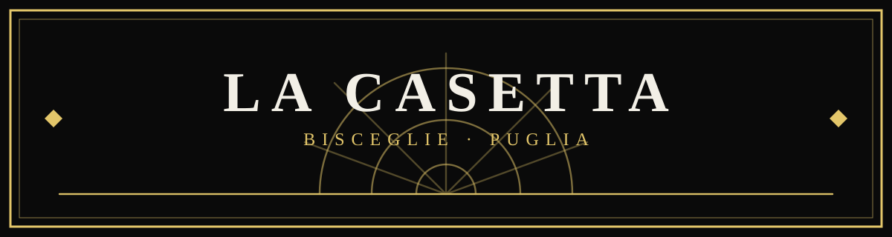

<p align="center">
  
</p>

<h3 align="center">Un appartement au cœur du centre historique, à une minute du port.</h3>

<p align="center">
  <a href="https://lacasettaa.netlify.app"></a>
</p>

---

### ◆ Le projet

Le site de réservation de **La Casetta**, appartement de vacances à Bisceglie, sur la côte adriatique des Pouilles. Il est écrit à la main, **sans framework, sans serveur et sans base de données** : du HTML, du CSS et du JavaScript, généré par un script PowerShell.

| | |
|---|---|
| ◆ **Langues** | français · italiano · English · Deutsch |
| ◆ **Style** | Art déco, noir et or, mode nuit par défaut |
| ◆ **Réservation** | devis en direct, demande par WhatsApp ou e-mail, devis PDF |
| ◆ **Calendrier** | un simple fichier `reservations.json`, géré depuis un espace hôte protégé |
| ◆ **Guides** | plages, aéroport de Bari, transports en direct, que faire autour |
| ◆ **Météo** | prévisions, lever et coucher du soleil en direct |

### ◆ Pourquoi pas de serveur ?

Parce qu'un appartement n'a pas besoin d'une usine à gaz : un site statique est rapide, gratuit à héberger et n'a rien à pirater.

```text
   voyageur ──▶ site statique ──▶ demande WhatsApp / e-mail
                     ▲                      │
                     │                      ▼
          reservations.json ◀── espace hôte (confirmation)
```

<p align="center"><sub>◆ ◆ ◆</sub></p>
<p align="center"><sub>Fait avec soin, entre mer et vieilles pierres.</sub></p>
